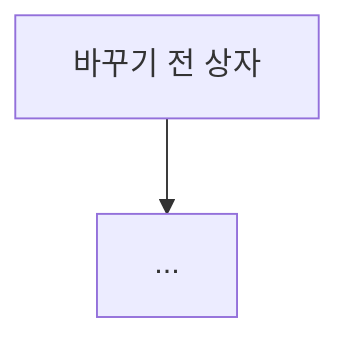
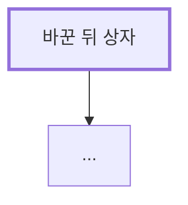

## 무엇을 왜

<!-- 바꾼 것과 바꾼 이유를 2~4줄로 쓴다. -->

## As-is

<!-- 바꾸기 전 모양. To-be와 같은 종류·같은 상자 이름으로 그린다. 글만 바뀌면 "구조 변화 없음"이라고 쓴다. -->

## To-be

<!-- 바꾼 뒤 모양. 바뀐 상자는 :::changed로 칠한다. -->

## 확인

<!-- 돌린 확인과 결과. AGENTS.md "고친 뒤 확인" 참고. -->

- [ ] `python3 scripts/build_agents.py --check`
- [ ] 장표 skill을 고쳤으면 `python3 skills/draw-diagram/scripts/render_slide.py --check`

## 설치한 사람이 할 일

<!-- link를 다시 걸어야 하는지 등. 없으면 "없음". -->
