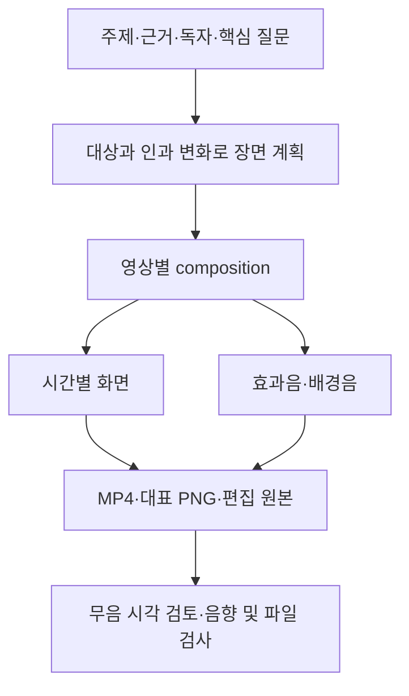

# 모션그래픽 스킬 개편

상태: 구현·기술 검증 완료 (2026-11-28), 최초 견본 사용자 느낌 확인 대기

## 문제

사용자는 대본·대사를 따라 읽는 느낌보다 영상 자체를 보고 자연스럽게 이해되는 모션그래픽을 원한다. LinkedIn에 게시할 10~30초 영상이며, 기술을 어느 정도 아는 사람이 대상이다. grill-me 인터뷰를 마쳤고 사용자가 4:5 비율 수정 후 “확정하고 구현”이라고 승인했다.

## 지금 구조

현재 저장소와 확인한 설치 경로에 motion-graphics는 없다. 삭제 커밋은 b2892a6ce0772be584e3dbb714584562ca171712, 삭제 직전 버전은 d912090cf7144bc48d5c5ac20639148d3d04fe52다. 아래 근거는 모두 삭제 직전 skills/motion-graphics/ 기준이다.

- SKILL.md:56,96: 자막이 설명을 맡으며 자막만 읽어도 단계를 이해하도록 요구했다.
- scripts/render_motion.py:160-165: 자막이 없으면 검증에 실패했다.
- assets/motion.html:374-392: 자막 글자 수로 단계 체류 시간을 정했다.
- SKILL.md:16,29,95: 고정된 상자·관계에서 상태만 바뀌며 데이터 내부의 값·모양 변화는 제한됐다.
- 출력은 재생·멈춤·단계 이동·상자 설명이 있는 HTML이며 MP4 내보내기는 없었다.

## 목표와 범위

- 기술 원리, 업무 장면, 개념 비교를 지원한다. 범위는 주제별로 다루되 한 영상에서는 전달할 핵심을 좁힌다.
- 대상의 이동·비교·계산·변형과 그 결과가 설명을 맡는다. 장식적인 선 점멸이나 글자의 순차 등장만으로 설명을 대신하지 않는다.
- 기술을 어느 정도 아는 독자를 기본으로 하고, 주제에 필수적인 낯선 용어는 해당 대상 곁에서 짧게 풀어 준다.
- 화면 글자는 이름·값 중심이고 꼭 필요한 지점에만 짧은 설명 한 줄을 허용한다.
- 기본 연출은 담백한 설명 흐름에 필요한 확대·전환을 더한다. 모든 주제를 같은 상자·화살표나 동일한 전후 구조에 넣지 않는다.
- 내레이션 없이 짧은 효과음·배경음을 사용한다. 소리는 이해를 보조하며 무음에서도 핵심이 전달되어야 한다.
- 기존 motion-graphics 이름 아래 새 제작 흐름을 구성하는 안이다. 삭제 전 HTML 엔진의 복구는 요구하지 않는다.
- 사용자 요청으로 폐기·삭제한 별도 animate-diagram 기획과 샘플은 복구하지 않는다. 자동 게시, 다른 skill의 호출 규칙 변경, 범용 타임라인 편집기, 여러 렌더러 지원은 이번 범위에 넣지 않는다.

## 제약과 기본값

사용자 제약은 LinkedIn 게시, 10~30초, 가로:세로 4:5, 기술을 어느 정도 아는 시청자, 이름·값 중심의 글자, 담백한 연출과 확대·전환, 말 없는 효과음·배경음이다. 사용자가 최종 확인에서 화면 비율을 명시했으므로 단순 agent 기본값과 구분한다.

다음은 agent가 제안한 조정 가능한 기본값이며 최종 확인 대상이다.

- 20초를 시작점으로 삼고 내용에 맞춰 10~30초에서 조정한다. 길이를 채우려고 장면을 늘리거나, 맞추려고 전체를 무작정 배속하지 않는다.
- 납품 영상은 가로:세로 4:5를 기준으로 하며 1080×1350, 30fps로 만든다. 다른 비율은 사용자가 별도로 요청할 때만 사용한다. 해상도를 조정해도 4:5를 유지한다. 필수 내용을 화면 가장자리에서 띄운다.
- 레퍼런스가 없으면 어두운 중립 배경과 절제된 강조색, 읽기 쉬운 한글을 사용한다. 스타일은 변경 가능하다.
- 게시 파일은 MP4(H.264, yuv420p, AAC audio)를 기본으로 하고 대표 PNG와 편집·재생성 원본을 함께 남긴다. codec 지원은 구현 초기 실험에서 검증한다.
- 결말을 잠시 유지해 메시지를 읽고 끝내는 구성을 기본으로 한다. 반복 재생 때문에 실제 원인·결과가 역전되어 보이게 만들지 않는다.
- 소리는 장면에 맞는 낮은 배경음과 필요한 순간의 효과음으로 구성한다. 최초 견본은 직접 합성한 소리로 만들 수 있으며 재생성 원본에 포함한다. 외부 assets를 쓰면 사용 조건과 출처를 남긴다.
- 일반적인 영상 제작 요청에서는 문맥으로 알 수 있는 조건을 다시 묻지 않고 초안까지 만든다. 사용자가 사전 기획 확인을 요청했거나 중요한 사실이 비어 있을 때만 먼저 묻는다.
- 공개 저장소 예시는 일반 도메인의 가상 값으로 쓴다. 다른 skill의 script를 import하지 않고 실행 의존성·폰트 조건을 명시한다.

## 설계 후보와 선택안

메인과 독립 판단 모델이 서로의 후보를 보지 않고 아래 두 방향을 비교했다.

| 후보 | 내용의 원본 | 장점 | 비용 |
| --- | --- | --- | --- |
| 정해진 장면 유형과 동작 문법 | shot JSON | 반복 배치·검사를 쉽게 재사용 | 새 주제마다 유형·문법 확장이 필요하고 표현이 틀에 갇힐 수 있음 |
| 영상별 자유 장면과 공통 내보내기 | composition | 기술 원리·업무 상황·개념 비교에 맞는 대상을 직접 표현 | 영상마다 장면 코드와 의미·가독성 검토가 필요 |

선택안은 **영상별 자유 장면과 공통 내보내기**다. 색·글꼴·도형은 재사용하되 모든 변화를 표현하는 새 DSL은 만들지 않는다.

- skill은 근거 확인, 핵심 질문, 시각 스토리보드, 품질 판단 절차를 소유한다.
- 영상별 composition은 대상 ID·배치·전체 상태·시간·전환을 소유한다. 스토리보드는 의도를 기록하며 실행 상태를 중복 소유하지 않는다.
- renderer는 같은 절대시간에 같은 의미의 화면을 만든다. 앞 장면을 재생해야 다음 장면이 맞는 숨은 상태를 두지 않는다. 실제 timer나 원격 asset 응답으로 캡처 시점이 달라지지 않게 한다.
- 공통 도구는 프레임 생성·음원 결합·인코딩·파일 검사를 맡는다. 사용자에게 좌표·프레임별 코드를 정하게 하지 않는다.
- HTML/SVG 장면과 Playwright/Chrome 캡처, FFmpeg 인코딩을 구현했다. 한글·합성 오디오·H.264/AAC·새 프로세스 재생성을 실제 실행으로 검증했다. FFmpeg는 PATH/명시 환경변수 또는 imageio-ffmpeg로 찾는다.

## 동작

| # | 동작 | 증명 |
| --- | --- | --- |
| B1 | 주제·자료를 받으면 이미 알려진 사용 조건을 적용하고 핵심 하나를 담은 장면을 만든다. | S1/S2: 세 예제 composition과 SKILL의 주제·근거·독자→장면 흐름 구현; 최초 cache 견본 사용자 확인 대기. |
| B2 | 기술 원리는 데이터·값·구조 변화, 업무 장면은 실제 대상과 처리 결과, 개념 비교는 같은 사례의 차이로 표현한다. 하나의 고정 모양에 맞추지 않는다. | S2: cache/order-entry/counterparts를 같은 render_motion.py로 생성; 모두 20초·1080×1350·30fps, full decode 통과. |
| B3 | 이름·숫자·단위를 유지하고 필요할 때만 한 줄 설명을 쓴다. 문장을 읽어야만 알 수 있는 원인·결과는 장면을 다시 구성한다. | S1/S2: 대표 PNG·주요 프레임·390px 축소본 직접 확인. cache 숫자/라벨 겹침, 주문서 edge, 비교 결과 표현을 수정 후 다시 렌더. |
| B4 | 주요 대상의 정체성·값·순서가 확대·이동·전환 이후에도 이어진다. 움직임이 근거 없는 처리·계산·시간 단축을 암시하지 않는다. | S1/S2: 각 예제 주요 시점 역순·반복 검사의 의미 상태와 raster 일치(16/18/20회). 주문 A-104 필드와 cache A→42 대응 확인. |
| B5 | 장면의 변화와 관찰 시간을 기준으로 10~30초를 구성한다. 무음 상태에서도 의미가 이어지며 소리는 보조한다. | S1/S2: 20초 영상과 합성 WAV 생성, AAC 결합·전체 decode 통과. peak/RMS·endpoint·clipping 수치 검사; 실제 청감과 사용자 이해 확인은 대기. |
| B6 | MP4·대표 PNG·편집 원본과 재생성 명령을 납품하고 실제 크기·길이·검사 결과를 기록한다. 재생성에 필요한 assets·fonts 조건을 남긴다. | S1/S2: MP4·대표 PNG·검수 이미지·audio.wav·source/ 생성. 업무/비교는 source만으로 새 process 재생성해 MP4/PNG/WAV hash 일치. |
| B7 | 읽기 어려움, 사실 불일치, 잘림, 재생 실패가 있으면 고친 뒤 재검사하며 미해결 제한을 숨기지 않는다. | S1: CLI test 4개 통과; 비율·길이·bool/비유한 숫자 거부와 실제 MP4+AAC end-to-end smoke 실행. 발견된 시각 겹침 수정. |
| B8 | skill 설치 없이 남아 있는 기존 draw-diagram/teach-me/grill-me 기능과 파일은 변경하지 않는다. 새 skill은 자기 의존성으로 실행한다. | 기준 861df3ce01e8c55befc828c63c81c9b8a799b59f 대비 기존 다섯 skill의 git diff --exit-code=0. 신규 skill은 local .venv/node_modules로 실행. |

## 대표 사례와 합격 기준

일반 도메인의 가상 데이터를 쓴다. 같은 제작 경로가 아래 세 종류를 표현하는지 확인한다. 세 장면 템플릿을 영구히 강제하는 규칙은 아니다.

1. **기술 원리 — cache**: 첫 요청이 계산·저장을 거치고 같은 요청은 저장된 결과를 가져온다. 요청 ID·결과 값이 이어지고, 설명 문장 없이 두 경로의 차이가 보인다.
2. **업무 상황 — 주문 재입력**: 같은 주문의 여러 필드를 다시 입력하던 흐름과 필드가 자동 전달되어 확인하는 흐름을 비교한다. 값의 대응·누가 확인하는지가 보이며 실측하지 않은 시간·정확도 향상을 주장하지 않는다.
3. **개념 비교 — DE와 FDE의 주된 카운터파트**: 데이터 전문 직군과 해당 업무의 실무자·책임자라는 차이가 같은 사례에서 드러난다. 단순 직업명 점멸로 끝내지 않고 협업 대상과 결과의 대응을 보여 준다. 배타적 경계나 우열로 표현하지 않는다.

최초 시각 기준 영상은 cache 사례를 제안한다. 원리를 보기 쉬운 사례로 연출·가독성을 먼저 맞춘 뒤 다른 종류에도 통하는지 확인한다.

합격 기준:

- MP4 전체 decode, 길이·해상도·4:5 비율·fps·영상/오디오 stream·대표 PNG 시점을 확인한다.
- 주요 시점과 전환 경계에서 값·대상·관계가 맞고, 원래 크기와 휴대폰 폭에서 한글·라벨이 읽힌다.
- 같은 시점을 재호출하거나 순서를 바꿔도 의미 상태가 같다. raster 미세 오차가 있으면 범위와 원인을 기록한다.
- 전체 영상을 무음으로 보고 대상·변화·결과를 설명할 수 있는지 검토한다. 자동 검사로 이해도를 증명했다고 말하지 않는다. 최초 기준 영상은 사용자의 느낌 확인도 받는다.
- 소리를 켜고 효과음이 의도한 사건과 맞는지, 잘림·갑작스러운 시작/끝·거슬리는 크기가 없는지 듣는다.
- 편집 원본으로 새 프로세스에서 다시 생성한다. LinkedIn 실제 업로드·피드 재생은 별도 요청 없이는 검증 완료로 표시하지 않는다.

## test할 seam

- **composition의 절대시간 renderer**: 주요 상태·ID·값·시간 순서 독립성을 확인한다. 사람의 이해도는 증명하지 못한다.
- **export 결과**: decode·stream·duration·크기·오디오 존재·대표 시점을 확인한다. 사실 관계는 증명하지 못한다.
- **시각·음향 검수**: 주요 프레임·한 주기 재생·작은 화면·무음과 유음 시청으로 의미와 가독성을 확인한다. 모든 독자가 이해한다고 일반화하지 않는다.
- **원본 재생성**: 새 프로세스 재생성으로 의존성과 asset 누락을 확인한다. 실행 환경 차이를 모두 보장하지 않는다.

## 결정

| # | 결정 | 답 | 정한 쪽 | 상태 |
| --- | --- | --- | --- | --- |
| D1 | 설명 범위 | 기술 원리·업무 장면·개념 비교; 대상을 통해 자연스럽게 이해 | 사용자 요구와 대화 맥락 | 정해짐 |
| D2 | 화면 글자 | 이름·값 중심, 필요한 지점만 짧은 설명 한 줄 | 사용자 | 정해짐 |
| D3 | 사용처·독자 | LinkedIn, 기술을 어느 정도 아는 사람 | 사용자 | 정해짐 |
| D4 | 길이 | 10~30초 | 사용자 | 정해짐 |
| D5 | 기본 연출 | 담백한 설명 흐름 + 필요한 확대·전환 | 사용자 | 정해짐 |
| D6 | 소리 | 말 없이 짧은 효과음·배경음; 무음에서도 이해 | 사용자 | 정해짐 |
| D7 | 화면 비율 | 가로:세로 4:5. 다른 비율은 별도 사용자 요청 시에만 사용 | 사용자 (최종 확인에서 수정) | 정해짐 |
| A1 | 이름·위치·범위 | motion-graphics 개편, specs/motion-graphics-redesign.md, 기존 타 skill 변경 제외 | agent 제안 | 정해짐 |
| A2 | 출력·기본값 | MP4+PNG+편집원본, 20초·1080×1350·30fps·dark. 비율은 D7 준수 | agent | 정해짐 |
| A3 | 제작 shape | 자유 composition + 공통 exporter, 사용자에겐 핵심 질문과 결과만 | 메인·독립 판단 모델 후보 대조 | 정해짐 |
| A4 | 대표 사례·완료 기준 | cache 먼저, 업무 상황·개념 비교까지 같은 경로 검증 | agent | 정해짐 |
| E1 | 실제 renderer·codec·폰트·음향 설정 | Chrome/Playwright + FFmpeg, H.264/yuv420p/AAC, 로컬 한글 폰트, 직접 합성 WAV. 세 사례 실제 렌더 검증 | 실험 | 완료 |

## 근거와 검토 상태

- 초기 독립 검토는 삭제 전 고정 git 버전의 자막 계약·상태 표현·시간 결정·HTML 출력 구조를 확인했다.
- 메인과 독립 판단 모델은 서로의 후보를 보지 않은 상태에서 자유 composition와 제한된 shot 유형을 비교했고, 현재 요구에는 자유 composition을 조건부 추천했다.
- skill-creator 기준에 따라 이미 가능한 일을 설명하는 일반론보다 이번 요구를 바꾸는 지침을 남기고, 별도 schema·참고문서·템플릿은 실제 재사용 이점이 있을 때만 추가한다.
- 2026-11-28 [LinkedIn 지원 형식](https://www.linkedin.com/help/linkedin/answer/a564111)에서 MP4의 desktop/iOS/Android 공통 지원을 확인했다.
- 같은 날 [LinkedIn 영상 공유](https://www.linkedin.com/help/linkedin/answer/a7494039)에서 영상 게시 길이 범위와 중요 요소를 가장자리에서 띄우라는 안내를 확인했다. 실제 게시·재생은 미검증이다.
- 위 기획 확정 당시에는 구현 전이었다. 현재 구현·영상·음향 생성은 완료했고, 후반 slice 표와 검증 기록에 최신 상태를 기록한다.

## slice

사용자가 승인한 cache 견본 → 다른 종류 검증 → 설치 순서를 실행 가능한 단위로 나눴다. 추가 범위·승인 단계는 도입하지 않는다.

| # | 만드는 것 | 채우는 동작 | 먼저 끝나야 하는 slice | 증명 방법 | 상태 |
| --- | --- | --- | --- | --- | --- |
| S1 | cache 영상과 공통 export, 첫 제작 지침 | B1, B3, B4, B5, B6, B7, B8 | 없음 | 20초 cache MP4 668,507 bytes, CLI 4 test 통과 | 파일 검증 완료, 사용자 느낌 확인 대기 |
| S2 | 업무 상황과 개념 비교 | B2, B3, B4, B5, B6, B7, B8 | S1 | 두 MP4 800,056/884,773 bytes; source 새 process 재생성 hash 동일 | 파일 검증 완료, 최종 시각 판단 진행 |
| S3 | 설치·재생성·독립 검토 | B1–B8 | S1, S2 | local .venv/node_modules, Codex skill link, validator/CLI 6 tests, 3방향 검토 및 재검토 통과 | 완료 |

## 회귀 경계

현재 motion-graphics는 삭제 상태여서 재현할 기존 실행 출력은 없다. draw-diagram/teach-me/grill-me 등 기존 skill은 구현 범위 밖이며 파일을 바꾸지 않는다. 기준 git tree와 작업 후 tracked 파일 blob을 대조해 그 파일들이 동일함을 확인한다. 기존 renderer를 수정하지 않으므로 과거 출력 전체를 다시 굽는 대신 입력/실행 파일 동일성을 확인하며, 이것을 출력 golden-master 실행이라고 표현하지 않는다.

## 현재 실행 증거 (2026-11-28)

- 메인이 isolated .venv + local node_modules로 `MOTION_RENDER_SMOKE=1 skills/motion-graphics/.venv/bin/python -m unittest discover -s specs/motion-graphics-redesign-tests -p 'test_*.py' -v` 실행: 4 test OK, 29.083초. 실제 Chrome/FFmpeg로 10초 MP4+AAC 생성 포함.
- skill-creator quick_validate: Skill is valid. `git diff --check` 통과. 설치용 runtime과 node_modules는 .gitignore로 제외한다.
- cache MP4 SHA256: 9eb2e8c2a8af0988609e6e0a8164ae401d30403894d6b38a413bf73d82508291.
- order-entry MP4 SHA256: 6f67b51770e15bd00677a4462e22f35aadb4be2ab1b714bb2dc5cf622a12e8b9.
- counterparts MP4 SHA256: ff4b68fc24a03101d874aa319256be449af35755df78682257c0763a613d77d6.
- 메인 도구의 오디오 입력은 지원되지 않아 실제 청음 완료라고 표시하지 않는다. 소리의 수치 검사와 사용자 피드백을 구분한다.

## 독립 검증 기록 — 1차

2026-11-28. 새 independent_reviewer 세 명이 각자 spec·규칙·깨뜨리기 관점에서 manifest b973a54e63eefb929918cdb362497e9817274e3f48f5ff3b7fdb74fe0375cb9f의 16개 파일을 확인했다.

- spec: 주요 프레임/390px 이미지/각 MP4 전체 decode 확인. 시각·의미의 필수 수정 없음. DOC-1(P3): 초기의 “아직 구현하지 않음” 문장이 남아 현재 상태와 충돌 → 메인이 초기 기록임을 명시해 수정.
- 규칙: R1(P2) Pillow>=10 선언과 12.1에 추가된 get_flattened_data 호출의 불일치 → 최소 버전을 맞추기로 수용. R2(P2) 별도 비율 요청을 허용하는 지침과 무조건4:5 검사의 불일치 → 명시적 --allow-other-aspect 경로와 source 재생성 flag 보존으로 수정.
- 깨뜨리기: BR-1(P2) HTML이 참조하는 local CSS가 assets에 등록되지 않으면 source에서 빠졌고 재생성 영상이 달라져도 성공 → 실제 3회 render와 중앙 pixel 빨강/흰색 차이로 재현. 선언되지 않은 local 참조와 실패한 자산 요청을 검출하고, 선언된 자산은 함께 내보내도록 수정. 입력 계약에 assets 등록 조건 명시.
- 위 수정은 승인된 B6/B7의 정확성과 재생성 조건을 충족시키는 수정이며 작업 범위·사용자 선호 변경은 아니다.
- 전체 실제속도 시청과 실제 청음은 reviewer가 수행하지 않았으며, 최초 기준 영상 사용자 피드백은 별도 대기 중이다.

### 1차 발견 수정 후

- Pillow 최소 버전을 12.1로 맞췄다. 4:5 외 비율은 --allow-other-aspect로만 허용하고, 원본 재생성 안내에 flag를 보존한다.
- capture는 scene과 등록된 assets, 로드에 실패한 요청을 검사한다. 초기 미등록 CSS, 실행 중 미등록 fetch, 등록했으나 로드에 실패한 fetch는 모두 오류로 중단한다. 등록된 CSS는 원본에 포함되며 별도 프로세스로 재생성해도 같은 빨간 PNG가 나온다.
- 수정 worker의 공개 CLI 테스트 6개가 22.61초에 통과했다. reviewer의 누락 CSS 재현 자료도 다시 실행해 0.64초에 exit 1과 assets 오류를 확인했다.
- cache 원본을 별도 프로세스에서 재생성한 MP4·WAV·PNG의 hash가 일치했다. 세 납품 영상의 픽셀과 타이밍은 바뀌지 않았다. 실제 청감과 사용자 느낌 확인은 별도로 대기한다.

### 2차 재검토 및 설치

- rules reviewer: R1/R2 해결 확인. source 안내의 비율 override flag 보존도 확인.
- break reviewer: 원래 미등록 CSS fixture의 exit 1을 확인했다. assets 등록 후에는 성공했고, 내보낸 script와 composition으로 새 프로세스에서 재생성한 PNG의 SHA256도 동일했다(ef2037b29fb8fabeb46c9b75cc53c66c65f78c2201ebc9c15a3b8a4946e3aca8). BR-1 철회.
- 메인이 로컬 .venv와 node_modules로 공개 CLI 테스트 6개를 다시 실행했다. 22.629초에 모두 통과했고 quick_validate와 git diff --check도 통과했다.
- Codex user skills 폴더에 신규 skill symlink 설치, 설치된 경로의 .venv Python과 exporter로 cache composition --check-only 실행: Composition valid. 설치 대상은 이 작업의 관리 worktree이며 스킬이 이를 참조하는 동안 해당 worktree를 보존한다.
- 각 예제의 HTML·JSON, 공통 script, 의존성, 재생성 안내를 보존한다. 생성한 영상은 저장소 밖 납품 폴더에 둔다.
- 코드·파일·주요 프레임 검토를 마쳤다. cache MP4를 대화에 표시하고 앱 미리보기로 열도록 요청했으며, 사용자에게 움직임과 소리의 느낌을 물었다. 아직 답이 없으므로 사용자 승인이나 실제 청음 완료로 표시하지 않는다.
